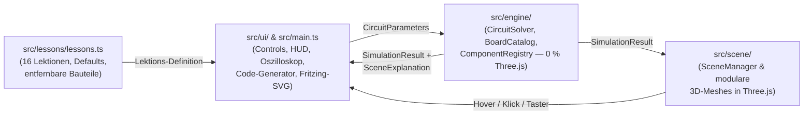

# Architektur — Learn ESP32 3D

Dieses Dokument beschreibt den modularen Aufbau der Plattform und zeigt, wie du eigene 3D-Bauteile, Sensoren und Lektionen sauber ergänzt.

---

## 1. Strikt getrennte Schichten

Die Anwendung trennt Simulationsphysik, Lektionsdaten, 3D-Visualisierung und Benutzeroberfläche in vier unabhängige Schichten:



### `src/engine/` — Reine Simulations-Logik (0 % Three.js)
- **`CircuitSolver.ts`**: Nimmt `CircuitParameters` + `elapsedSeconds` entgegen und liefert ein deterministisches `SimulationResult` (Knotenspannung, Strom, Leistung, Logikpegel, ADC-Wert, Warnungen sowie die Live-Erklärung `explanation: { whatHappens, whyItHappens }`).
- **`BoardCatalog.ts`**: Definiert die 6 unterstützten ESP-Modelle (inkl. Abmessungen, Antennentyp, Dual-USB, ESPHome-Varianten und logischem Pin-Mapping `outA`, `inputA`, `adc`, `sda`, `scl`, `uartTx`, `uartRx`).
- **`ComponentRegistry.ts`**: Zentrale Registry für Bauteil-Metadaten, LED-Kennwerte (`LED_SPECS`), LDR-Kennlinie und IEC-60062-Farbring-Berechnung (`getResistorColorBands()`).
- **Vorteil:** Die komplette Physik lässt sich ohne WebGL/DOM isoliert testen oder in andere Frontends übernehmen.

### `src/lessons/` — Deklaratives Lektions-System
- **`lessons.ts`**: Jede Lektion ist ein typisiertes Objekt (`LessonDefinition`) mit Kategorie, dynamischer Pin-Auflösung (`getPrimaryPin(boardId)`), Formeln, Kernkonzepten, Experimenten, `removableParts` (welche Bauteile zur Fehler-Simulation herausgezogen werden können) sowie `defaultParams` und `cameraPreset`.

### `src/scene/` — Modulare 3D-Darstellung (Three.js)
- **`SceneManager.ts`**: Verwaltet `WebGLRenderer`, `PerspectiveCamera`, `OrbitControls`, Beleuchtung, Dark/Light-Theme, `ResizeObserver` auf dem Container sowie Raycasting für **3D-Hover-Tooltips**, den **klickbaren 3D-Taster** und **Klick-zum-Entfernen** von Bauteilen.
- **`src/scene/components/`**: Jedes Bauteil ist eine eigenständige Klasse mit einer `public readonly group = new THREE.Group()` und gezielten Update-Methoden (z. B. `setResistance()`, `updateVisuals()`, `setAngle()`).
- **Aufbau „Ohne Breadboard“:** `SceneManager` blendet bei `params.withoutBreadboard === true` das Steckbrett aus, setzt zwei `WagoClampMesh` (WAGO 221-415) auf die Arbeitsmatte und leitet Stromschienen-Anschlüsse automatisch auf die WAGO-Ports um.

### `src/ui/` — Engineering-UI & Instrumente
- **`TelemetryHud.ts`**: Drosselt normale DOM-Updates auf 5 Hz (200 ms) für ruhige Messwerte, aktualisiert bei Benutzerinteraktion aber sofort (`forceImmediate = true`).
- **`Oscilloscope.ts`**: HiDPI-2D-`<canvas>` mit eigenem `ResizeObserver`, `VIH`/`VIL`-Schwellen und `HOLD`/`RUN`-Steuerung.
- **`CodeGenerator.ts` & `FritzingSchematic.ts`**: Generieren aus denselben `CircuitParameters` + `SimulationResult` den passenden Arduino-C++-Code, ESPHome-YAML und den dynamischen Fritzing-SVG-Schaltplan.

---

## 2. Anleitung: Ein neues 3D-Bauteil hinzufügen

Beispiel: Du möchtest einen neuen Sensor (z. B. einen **DHT22 Temperatur-/Feuchtesensor**) ergänzen.

### Schritt 1: Bauteil in der Registry registrieren
Öffne `src/engine/ComponentRegistry.ts` und füge einen Eintrag in `registerBuiltins()` (oder per `defaultComponentRegistry.register(...)`) hinzu:

```ts
this.register({
  type: 'dht22-sensor',
  displayName: 'DHT22 Temperatur- & Feuchtesensor',
  category: 'sensor',
  description: 'Digitaler Eindraht-Sensor mit 10 kΩ Pull-Up-Widerstand auf der Datenleitung.',
  pins: [
    { id: 'VCC', label: '3,3 V', type: 'power' },
    { id: 'DATA', label: 'DATA', type: 'gpio' },
    { id: 'GND', label: 'GND', type: 'ground' },
  ],
  defaults: { tempC: 21.5, humidityPct: 50 },
  specs: { 'Protokoll': '1-Wire (proprietär)', 'Genauigkeit': '±0,5 °C' },
});
```

### Schritt 2: 3D-Mesh-Klasse anlegen
Erstelle eine neue Datei `src/scene/components/Dht22Mesh.ts`:

```ts
import * as THREE from 'three';

export class Dht22Mesh {
  public readonly group = new THREE.Group();

  constructor(pinPositions: THREE.Vector3[]) {
    this.group.name = 'DHT22_Sensor';
    const center = pinPositions[1].clone();
    this.group.position.copy(center);

    // Gehäuse + Beinchen modellieren und zu this.group hinzufügen
    const body = new THREE.Mesh(
      new THREE.BoxGeometry(1.1, 1.35, 0.45),
      new THREE.MeshStandardMaterial({ color: 0xf8fafc, roughness: 0.4 }),
    );
    body.position.y = 1.05;
    body.castShadow = true;
    this.group.add(body);
  }
}
```

### Schritt 3: Simulation & Lektion anbinden
1. **`src/engine/types.ts`**: Neuen Topologie-Namen zu `CircuitTopologyId` und ggf. Parameter zu `CircuitParameters` ergänzen.
2. **`src/engine/CircuitSolver.ts`**: Neue `solveDht22(...)`-Methode ergänzen (inkl. Verhalten bei entfernten Bauteilen über `isRemoved(params, '...')` und `explanation`).
3. **`src/lessons/lessons.ts`**: Neue `LessonDefinition` in `LESSONS` eintragen (inkl. `removableParts`, `formulas` und `defaultParams`).
4. **`src/scene/SceneManager.ts`**: Im `switch (params.topology)` in `rebuildCircuitLayout()` dein `Dht22Mesh` instanziieren und mit `this.registerPart(mesh.group, { partId, name, ... })` anmelden — damit funktionieren **Hover-Tooltip** und **Klick-zum-Entfernen** sofort automatisch!
5. **`src/ui/`**: Parameter-Regler in `ControlsPanel.ts`, Code-Templates in `CodeGenerator.ts` und SVG-Darstellung in `FritzingSchematic.ts` ergänzen.

### Schritt 4: Prüfen
```bash
npm run typecheck
npm run build
```
